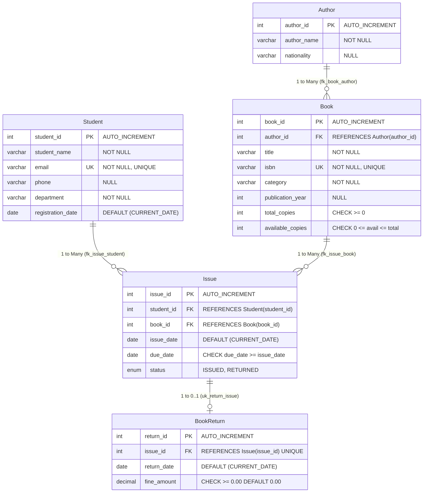

# Library Management System — RDBMS Laboratory Demo
**Course:** Relational Database Management Systems (RDBMS) Lab  
**Institution:** Department of Computer Science & Engineering, Manipal University Jaipur  
**Engine & Tech Stack:** React (Vite) + Tailwind CSS + Node.js (Express) + MySQL 8.0 (InnoDB)

---

## 1. Project Overview

The **Library Management System** is an end-to-end, academic-grade database web application designed to demonstrate practical relational database concepts during laboratory and viva evaluations. 

Unlike static mockups, the entire application is powered by a normalized relational database schema with real foreign-key enforcement, domain CHECK constraints, UNIQUE indexes, and transacted book checkout and return flows.

### Core Entities & Capabilities:
- **Student Registration:** Full student records with unique university emails and borrowing history tracking.
- **Author Directory:** 3NF normalized author records with referential integrity protection (`ON DELETE RESTRICT`).
- **Book Catalogue:** Inventory tracking with live availability counts, categorized filtering, and composite check constraints (`0 <= available_copies <= total_copies`).
- **Transactional Book Issue:** ACID transaction with row-level locking (`SELECT ... FOR UPDATE`), copy decrement, and date validation (`chk_issue_due_date`).
- **Return & Fine Calculation:** Transactional return workflow with real-time overdue day and fine calculation (`fine = max(0, return_date - due_date) × ₹5/day`).
- **Relational Reports:** Six dedicated reports featuring multi-table `INNER JOIN`, `LEFT JOIN`, `GROUP BY`, date arithmetic, and CSV export.
- **Interactive Database Overview & Viva Companion:** Interactive Entity-Relationship (ER) diagram, live `information_schema` dictionary, normalization breakdown, and live read-only SQL query runner.
- **12-Step Guided Demo Walkthrough:** Floating in-app checklist designed for university lab examiners.

---

## 2. Relational Database Design (Five Core Tables)

The database `library_management_system` strictly implements the five required core entities using MySQL 8.0+ and InnoDB:



> **Note on Table Naming:** In MySQL, `RETURN` is a reserved SQL keyword. The table is safely named `BookReturn` (with a corresponding `ReturnView` alias created in `schema.sql`) to ensure standard SQL compatibility and avoid syntax collisions.

---

## 3. Technology Stack

- **Frontend:** React 18, Vite 5, Tailwind CSS, Lucide React, Recharts
- **Backend:** Node.js 22, Express 4, CORS, Dotenv
- **Database Driver:** `mysql2/promise` (connection pooling, parameterized queries, transaction isolation)
- **Database Engine:** MySQL 8.0+ (InnoDB)

---

## 4. Local Installation & Setup

### Prerequisites:
- Node.js (v18 or higher) and npm installed.
- MySQL 8.0+ installed (via MySQL Community Server, XAMPP, or Laragon).

### Step 1: Clone or Navigate to Project Directory
```powershell
cd c:\Users\shwet\OneDrive\Desktop\RDBMS-ENDTERM-PROJECT-LAB
```

### Step 2: Configure Environment Variables
Copy `.env.example` to `.env` in the root folder:
```powershell
copy .env.example .env
```
Open `.env` and verify your MySQL credentials:
```env
PORT=5000
NODE_ENV=development

DB_HOST=localhost
DB_PORT=3306
DB_USER=root
DB_PASSWORD=your_mysql_password_here
DB_NAME=library_management_system

FINE_RATE_PER_DAY=5
```

### Step 3: Initialize the Database (Schema & Sample Data)
Run the automated initialization script:
```powershell
npm run db:init
```
*Alternatively, you can manually open MySQL Workbench or command line and run:*
```sql
SOURCE database/schema.sql;
SOURCE database/seed.sql;
```

### Step 4: Install Dependencies
```powershell
# Install root dependencies
npm install

# Install server dependencies
cd server
npm install
cd ..

# Install client dependencies
cd client
npm install
cd ..
```

### Step 5: Start the Application

You can run both server and client together or in separate terminals:

**Option A: Separate Terminals (Recommended for Development)**
- **Terminal 1 (Backend API):**
  ```powershell
  npm run server
  # Express backend runs on http://localhost:5000
  ```
- **Terminal 2 (Frontend Client):**
  ```powershell
  npm run client
  # Vite frontend runs on http://localhost:5173
  ```

**Option B: Production Single-Server Mode**
Build the frontend and run Express:
```powershell
npm run build --prefix client
node server/server.js
# Access complete app at http://localhost:5000
```

---

## 5. REST API Endpoints Specification

| Method | Endpoint | Description |
|---|---|---|
| `GET` | `/api/health` | Backend and MySQL connectivity diagnostic check |
| `GET` | `/api/dashboard/stats` | Aggregated metrics (students, authors, titles, copies, fines) |
| `GET` | `/api/dashboard/recent-issues` | Top 5 recent issue transactions with joined names |
| `GET` | `/api/dashboard/recent-returns` | Top 5 recent return transactions with fine details |
| `GET` | `/api/dashboard/overdue-alerts` | Active loans exceeding due date with calculated fines |
| `GET` | `/api/dashboard/category-stats` | Category distribution aggregated for charts |
| `GET` | `/api/students` | List all students (supports `?q=` search) |
| `POST` | `/api/students` | Register student (enforces UNIQUE email) |
| `PUT` | `/api/students/:id` | Update student information |
| `DELETE` | `/api/students/:id` | Delete student (blocked if issue records exist) |
| `GET` | `/api/students/:id/history` | Full borrowing history for student |
| `GET` | `/api/authors` | List authors with joined book counts |
| `POST` | `/api/authors` | Add new author |
| `PUT` | `/api/authors/:id` | Update author information |
| `DELETE` | `/api/authors/:id` | Delete author (blocked by FK if books reference author) |
| `GET` | `/api/authors/:id/books` | View all books authored by author |
| `GET` | `/api/books` | List books with joined author (supports search/filter) |
| `POST` | `/api/books` | Add book (enforces UNIQUE ISBN, checks copies) |
| `PUT` | `/api/books/:id` | Update book (validates copies >= active loans) |
| `DELETE` | `/api/books/:id` | Delete book (blocked by FK if issue history exists) |
| `GET` | `/api/books/categories` | Distinct categories for filter dropdown |
| `GET` | `/api/issues` | List all borrowing transactions |
| `GET` | `/api/issues/active` | List only active loans (`status = 'ISSUED'`) |
| `POST` | `/api/issues` | **Transactional Book Issue** (row lock, copy decrement) |
| `GET` | `/api/returns` | List return records |
| `POST` | `/api/returns/calculate` | Preview overdue days and fine before committing |
| `POST` | `/api/returns` | **Transactional Book Return** (status update, copy increment) |
| `GET` | `/api/reports/catalogue` | Report A: Complete Book Catalogue |
| `GET` | `/api/reports/active-issues` | Report B: Currently Issued Books |
| `GET` | `/api/reports/overdue` | Report C: Overdue Books |
| `GET` | `/api/reports/student-history` | Report D: Student Borrowing History |
| `GET` | `/api/reports/circulation` | Report E: Book Circulation (GROUP BY book/category) |
| `GET` | `/api/reports/fines` | Report F: Fine Summary & Returns Audit |
| `GET` | `/api/database/status` | Live database telemetry, table row counts, version |
| `GET` | `/api/database/schema-info` | Columns, keys, and constraints dictionary |
| `GET` | `/api/database/queries` | Metadata for 6 viva demonstration queries |
| `GET` | `/api/database/query-demo/:id` | Executes safe read-only SQL query against MySQL |

---

## 6. Automated & Manual Testing Checklist

### Automated Test Suite
When MySQL is connected, run:
```powershell
npm test
```
The test suite (`server/tests/run_tests.js`) automatically validates all 12 key RDBMS constraints:
1. All 5 core tables exist in schema.
2. Duplicate student email rejection (UNIQUE constraint `uk_student_email`).
3. Duplicate ISBN rejection (UNIQUE constraint `uk_book_isbn`).
4. Foreign key enforcement: book cannot reference non-existent author (`fk_book_author`).
5. CHECK constraint: `due_date >= issue_date` on Issue table.
6. CHECK constraint: `available_copies <= total_copies` on Book table.
7. CHECK constraint: `fine_amount >= 0.00` on BookReturn table.
8. ACID transaction atomicity and rollback on book issue failure.
9. Referential integrity blocks deleting student with active loans (`ON DELETE RESTRICT`).
10. Overdue report accurately calculates date arithmetic against `CURRENT_DATE`.
11. Unique constraint `uk_return_issue` prevents duplicate returns for the same issue.
12. Relational inventory consistency: `available_copies = total_copies - active_loans` for all books.

---

## 7. Lab Demo Walkthrough (12 Suggested Actions for Evaluation)

Click the **"Lab Demo Guide"** button in the app header or follow these steps:

1. **Dashboard Overview:** Show the 8 live KPI cards. Explain that all statistics are computed via real SQL `COUNT()`, `SUM()`, and `GROUP BY` queries.
2. **Add Author:** Go to **Authors** &rarr; "+ Add Author". Register e.g. "Dr. Rajeev Bansal".
3. **Add Book:** Go to **Books** &rarr; "+ Add Book". Select the new author, enter a unique ISBN, category, and set total copies to 3.
4. **Register Student:** Go to **Students** &rarr; "+ Register Student". Enter student name, email, department.
5. **Catalogue Search:** In **Books**, test partial title search (e.g. "Database") and category filtering.
6. **Issue Book:** Go to **Issue Books**. Select the registered student and book. Click "Issue Book". Show the alert confirming the transaction and notice the available copy count decreasing from 3 to 2.
7. **Verify Active Loan:** In **Issue Books** or **Reports &rarr; Report B**, show the newly created loan row.
8. **Return Book:** Go to **Return Books**. Click "Process Return". Show the fine preview. Confirm return. Notice available copies increase back to 3.
9. **Demonstrate Overdue Fine:** In **Return Books**, locate an overdue loan (e.g. Rohan Verma). Show how `overdue_days * ₹5` computes the fine.
10. **Database Overview:** Open **Database Overview**. Walk through the ER diagram, cardinalities (1:N, 1:0..1), and constraints.
11. **Test Duplicate Constraint:** Try registering another student with `aarav.sharma@jaipur.manipal.edu`. Show the MySQL `ER_DUP_ENTRY` error response.
12. **Test Foreign Key Restriction:** Try deleting an author who has books in the library. Show the `ON DELETE RESTRICT` error message.


## 9. Current Environment Status & Honest Disclosure

- **Operating System:** Windows 11
- **Node.js:** v22.19.0
- **npm:** v10.9.3
- **Vite Client:** Compiled cleanly (0 errors), dev server active on `http://localhost:5173`.
- **Express Backend:** Running on `http://localhost:5000`.
- **MySQL Status:** In the current developer machine environment, the standalone MySQL server service is not currently active on port 3306. The application is built with complete MySQL-backed code, automated connection diagnostics, and user-facing setup banners. Once MySQL is started and `npm run db:init` is executed, all live database features activate immediately without code modification.
